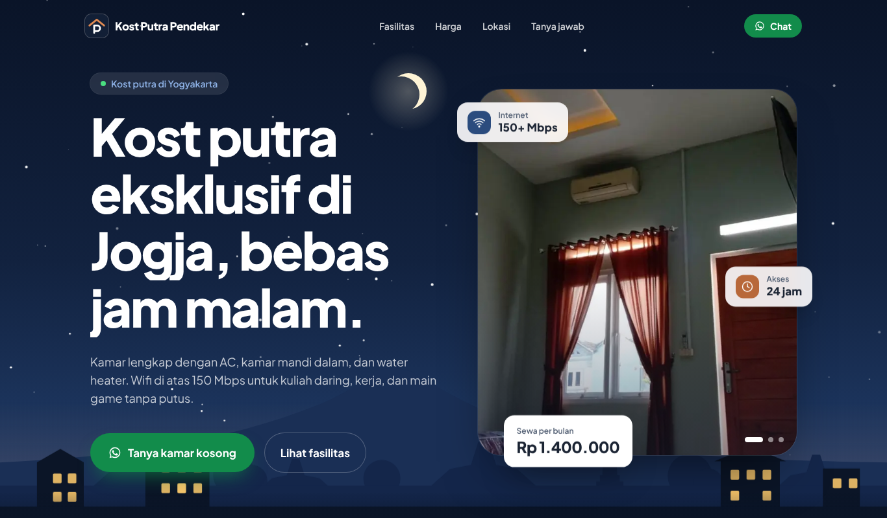

# Kost Putra Pendekar

A promotional landing page for **Kost Putra Pendekar**, a men-only boarding house (*kost*) in Yogyakarta, Indonesia. The page presents the rooms, facilities, price, photos, and location, and guides prospective tenants to contact the owner on WhatsApp.

It is a single static page with no backend, database, or authentication. The site content is in Indonesian.



## Features

- **Animated Yogyakarta night hero.** A hand-built SVG illustration of Mount Merapi, the Tugu Jogja monument, *joglo* rooftops, twinkling stars, a shooting star, and lit boarding-house windows. The layers move with a parallax effect on scroll.
- **Room photo slideshow** that crossfades automatically with a slow zoom, plus clickable indicators.
- **Bento-style facilities grid.** The Wi-Fi speed counts up when it comes into view, and the "no curfew" card has a rotating clock hand.
- **Photo gallery with a lightbox.** Photos open full size and can be browsed with arrow buttons, the keyboard (← → Esc), or swipe on mobile.
- **Pricing card** with a count-up animation and an animated glowing border.
- **FAQ** as an accordion.
- **Location map** embedded from Google Maps, with a button to open directions.
- **WhatsApp calls to action throughout**, each with a prefilled message. On mobile, a bottom bar keeps the price and chat button visible.
- **Share-ready.** Includes an Open Graph preview image for WhatsApp and social media, a favicon, and search-engine metadata.

## Tech stack

| Area | Tools |
| --- | --- |
| Framework | [Next.js 16](https://nextjs.org) (App Router, statically prerendered) |
| UI | React 19, TypeScript |
| Styling | Tailwind CSS v4 |
| Animation | [Motion](https://motion.dev) and CSS keyframes |
| Font | Plus Jakarta Sans, self-hosted via Fontsource |
| Images | `next/image` for responsive sizes and lazy loading |

## Project structure

```
app/
  layout.tsx            Metadata, fonts, and base page setup
  page.tsx              Composes all sections of the page
  globals.css           Colors, fonts, and CSS animations
  icon.svg, favicon.ico, apple-icon.png   Site icons
  opengraph-image.jpg   Preview image shown when the link is shared
components/
  chrome.tsx            Header, floating WhatsApp button, mobile bottom bar
  jogja-night.tsx       Animated Yogyakarta night illustration
  hero-slides.tsx       Hero photo slideshow
  gallery.tsx           Photo gallery and lightbox
  motion.tsx            Reusable animation helpers (reveal, count-up, etc.)
  icons.tsx, logo.tsx   Facility icons and logo
lib/
  data.ts               All page content: copy, price, contact, facilities, photos, FAQ
public/foto/            Room and building photos
```

Content is kept separate from presentation. To change the copy, price, WhatsApp number, facilities, photos, or FAQ, edit `lib/data.ts`. The components don't need to change.

## Getting started

Requires Node.js 20 or later.

```bash
npm install
npm run dev
```

Then open http://localhost:3000.

Other scripts:

```bash
npm run build   # production build
npm run start   # serve the production build
npm run lint    # run ESLint
```

## Adding or replacing photos

1. Put the image in `public/foto`. A JPG about 1200 px on its longest side is enough.
2. Add it to the `photos` array in `lib/data.ts` with an `alt` (description for screen readers) and a `caption` (label shown in the gallery).
3. The first three photos appear in the hero slideshow. Every photo except the first appears in the gallery.

## Accessibility and performance

- All animations stop when the visitor has "reduce motion" enabled (`prefers-reduced-motion`).
- Keyboard navigation is supported, with a "skip to content" link, visible focus states, and a lightbox built on the native `<dialog>` element.
- Every photo has alt text.
- The page is prerendered as static HTML, and the background illustration is SVG rather than large image files.

## Deployment

The project deploys to [Vercel](https://vercel.com) as is. Import the GitHub repository, select this project, and click Deploy. The default Next.js settings work without changes.
